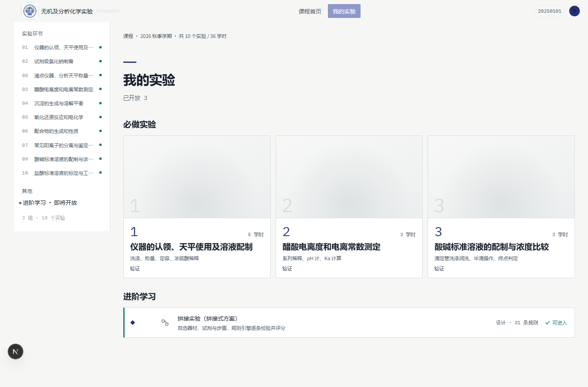
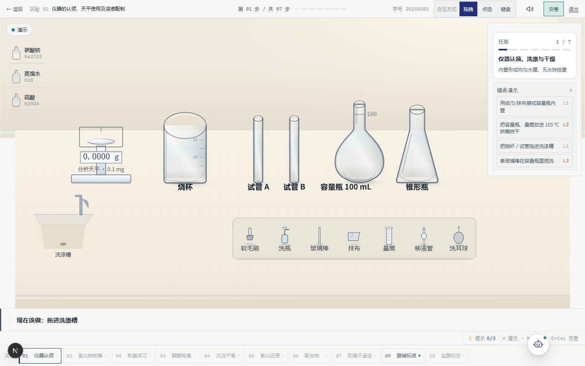
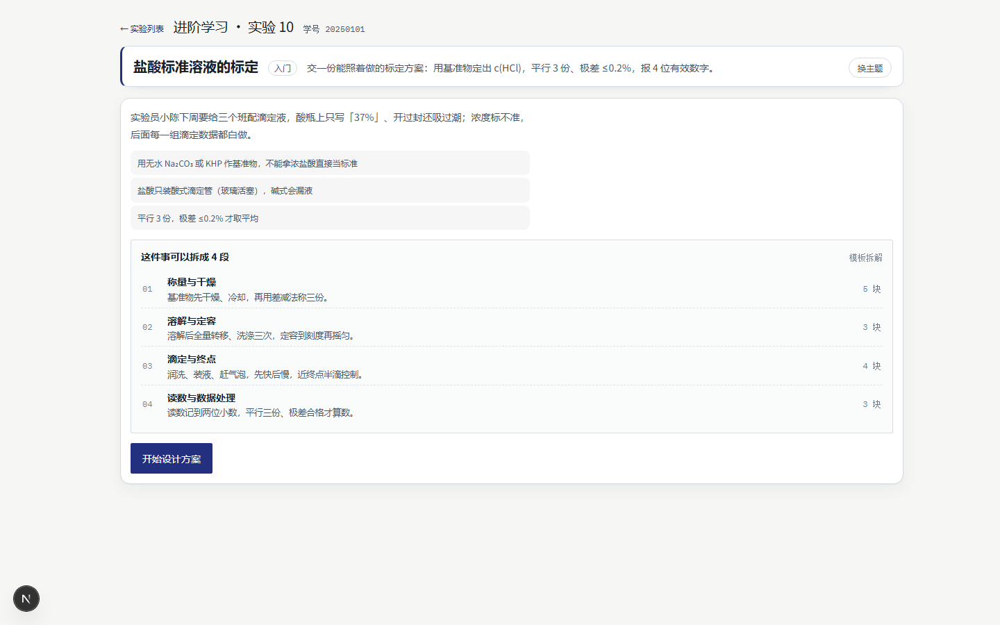
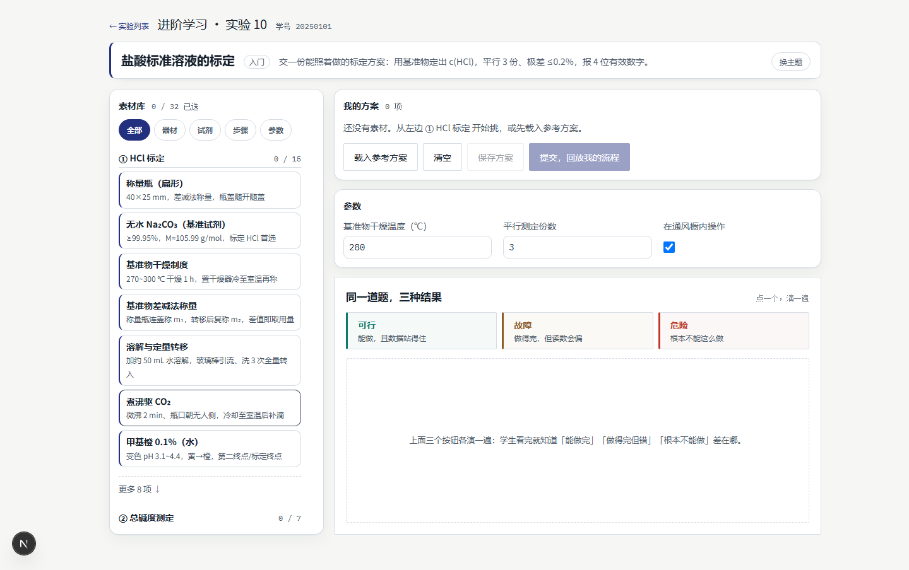
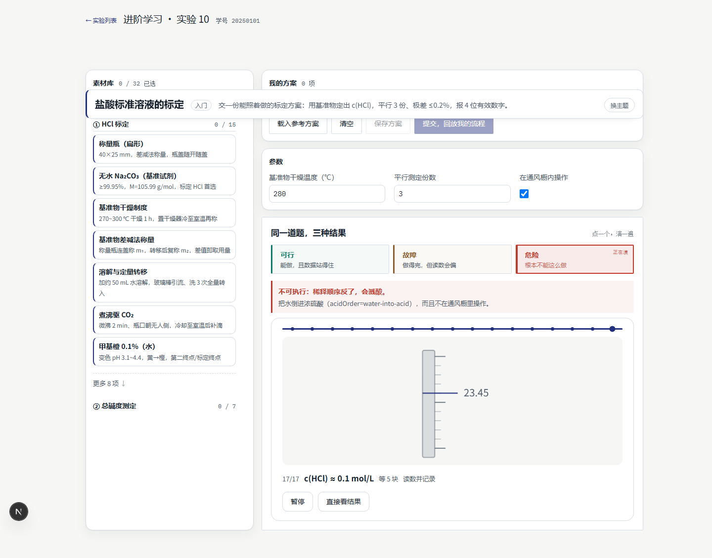
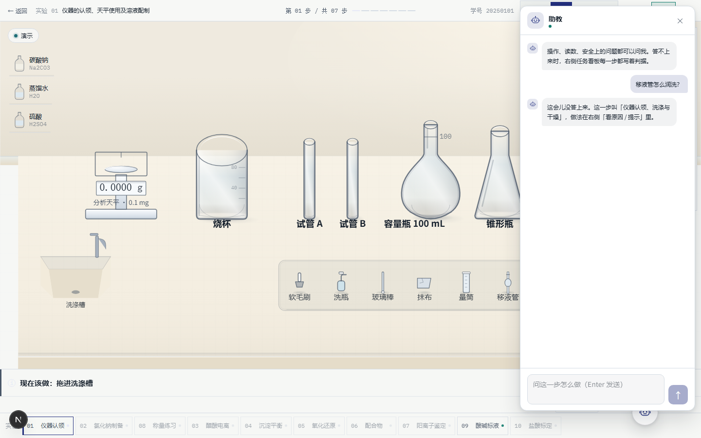

# chem-lab 验收说明书（第五轮收尾 · 2026-10-24）

> 这份是给**你自己手点**用的：从零构建 → 看实验台 → 看拼接实验 → 看 AI 助教 → 还剩哪些坑。
> 全流程都在本机跑，不连外网、不要 key。命令一行一条，粘到 Git Bash 里即可。

---

## 1. 怎么启动

### 1.1 从零构建（新克隆、或换台机器）

```bash
cd /e/workspace/public/NOBBBB/chem-lab

npm ci                      # 装依赖（Node 22 及以上；本机是 node 26.7 / npm 11.19）
npm run db:init             # 建本地库（PGlite，落在 .pgdata/，零安装）
npm run db:demo             # 播种演示班级：40 名学生 / 26 已完成
npm run dev                 # → http://127.0.0.1:3000
```

* **端口**：dev 固定 3000（`next dev -p 3000`）。改端口用 `npm run dev -- -p 3001`，但 e2e/证据脚本都默认 3000。
* **跑生产态**（就是部署产物，看动画最准）：

```bash
npm run build
npm run start               # → http://127.0.0.1:3000（默认 3000；扣子上由平台注入 PORT，一般 5000）
```

* **环境变量**：跑本地全流程**一个都不用设**。下面这些只在要接真模型 / 接线上库时才用：

| 变量 | 什么时候要 | 说明 |
|---|---|---|
| `PGLITE_DIR` | 想换库目录 | 默认 `./.pgdata`。跑 e2e 时配置里自动用 `.pgdata-e2e` |
| `DATABASE_URL` | 部署到扣子 | 线上容器文件系统只读，必须给真 PostgreSQL 连接串；不给就会 fallback 到 PGlite → `/api/*` 全 500 |
| `COZE_LLM_URL` + `COZE_LLM_KEY` | 本地接真模型 | OpenAI 兼容端点（方舟/扣子中转都行）。两个都给了才算「已配置」 |
| `ARK_API_KEY`（+ `ARK_BASE_URL`） | 本地接方舟 | 与上面二选一 |
| `LLM_CHANNEL` | 强制通道 | `auto`（默认）/ `sdk` / `http` |

> ⚠️ 本地库有个坑：**PGlite 被强杀会坏**。看到页面数据全空、接口 500、日志里 `RuntimeError: Aborted()`，
> 直接 `npm run db:init && npm run db:demo` 重建就好（前提：先把 dev/prod 停掉，它独占目录）。这一轮我自己踩了三次。

### 1.2 登录

打开任意页面会重定向到 `/login`。用学号 `20250101` / 姓名 `周若曦`（演示库里有 40 个人，demo 数据都在这个号上，报告页/教师端认它）。
不需要密码。

---

## 2. 看实验台（2D 台面 + 六套动作）

**URL**：<http://127.0.0.1:3000/experiments> → 点「实验 01 仪器的认领、天平使用及溶液配制」

或者直接 <http://127.0.0.1:3000/exp/exp01?force=1>（`?force=1` = 跳过顺序锁，直接进）




进去以后版面是：**左引导卡（现在该做啥）· 中间台面（天平/烧杯/试管/容量瓶/锥形瓶 + 试剂架 + 工具托盘）· 右侧任务看板 + 错误演示列表**。
右下角一个机器人图标 = AI 助教。

七步里六套动作，按这个顺序点，每步该看到什么：

| 步 | 怎么操作 | 该看到 |
|---|---|---|
| 1 仪器认领、洗涤与干燥 | 把**容量瓶**拖进**洗涤槽** | C1 洗涤：水柱落进瓶里 → 液面涨 → 毛刷伸进去来回刷 → 倒水 → 内壁挂水珠往下滑。约 1.9 秒 |
| 2 分析天平调水平与内校 | 点**天平** | 读数从 `0.0000 g` 滚起来；这一步不出秤量动作 |
| 3 差减法称 Na₂CO₃ | 再点一次**天平** | C5 称量：读数从 0 滚到 `1.0599 g`（约 0.9 秒） |
| 4 溶解、冷却与定量转移 | 把**蒸馏水**拖到**烧杯** | C3 加试剂（瓶飞过来、倾斜、倒水，约 1.1 秒）**接着** C2 搅拌（玻璃棒插进去画圈、颗粒变小消失、气泡上冒，约 1.9 秒）；烧杯液面到 0.30 |
| 5 容量瓶定容与摇匀 | 把**蒸馏水**拖到**容量瓶** | 先倾倒（C3），再 C6 定容：滴管悬在瓶口、三滴下落、液面涨、最后**悬滴**涨大再落下、液面弧线摆两下（摇匀）。整段 **1.67 秒**（上一轮 2.0 秒，这轮压进 2 秒口径） |
| 6 移液管润洗、移取与放出 | 把**移液管**拖到**锥形瓶** | C4 转移：吸管里的液柱下降、锥形瓶液面上来（约 2.0 秒） |
| 7 浓硫酸稀释 | 拖**硫酸** | 事故演出：酸入水 vs 水入酸的差别，L4 危险 |

* **动作随时可跳过**：动起来以后右下/右栏会出现「跳过」按钮，点了 0.4 秒内到终态（不再补播排水）。
* **拖动期间不播动作**（拖拽只跟手），松手才播 —— 这条 e2e 守着。
* 右侧「错误演示」四条可以点，点了会**演一遍错的后果但不扣分**（演示模式）。

帧率/时长实测见 `fps.json`（改前改后并列）与 `anim/data.json`（逐帧时长 + 终态液面/读数）。

---

## 3. 看拼接实验（主题 → 4 段拆解 → 设计 → 演三种结果）

**URL**：<http://127.0.0.1:3000/plan>

1. **选主题**：第一屏是四张主题卡（盐酸标定 / 醋酸电离度 / CO₂ 空白 / 纯碱总碱度）。点「盐酸标准溶液的标定」。
2. **看 4 段拆解**：选完自动出来「这件事可以拆成 4 段」——称量与干燥 / 溶解与定容 / 滴定与终点 / 读数与数据处理，每段带一句做法和块数。

   

3. **开始设计**：点卡片底部的「开始设计方案」，进入设计态：左边素材库（32 块，按①②分组）、中间「我的方案」、右边参数（基准物干燥温度 280℃ / 平行测定 3 份 / 通风橱勾选）。
4. **看三种结果**：右栏中部「同一道题，三种结果」，三个按钮一条一个：

   

   * **可行** —— 演示「能做，且数据站得住」
   * **故障** —— 演示「做得完，但读数会偏」
   * **危险** —— 演示「根本不能这么做」

   点任何一个，下面会按那套方案把 17 拍回放一遍（约 20~30 秒），**演完**在按钮下方出结论条。点「危险」，该看到：

   > **不可执行：稀释顺序反了，会溅酸。**
   > 把水倒进浓硫酸（acidOrder=water-into-acid），而且不在通风橱里操作。

   

   （回放中可以先「暂停」，或者「直接看结果」跳过剩下的拍。）

5. 自己拼完（三块以上）点「提交，回放我的流程」，会进评分：AI 点评 + 规则底线，不可执行的方案分数被封在 59 以下。

---

## 4. 看 AI 助教

**在哪**：实验台右下角那个**机器人图标**（不写「AI 助教」四个字，可以拖着走）。点一下开右侧全高抽屉。

**没有 key 时**（也就是现在这样，什么都不配）：

* 抽屉照常打开，头像是机器人，顶部状态点写着在线；
* 问一句「移液管怎么润洗？」→ 回一句本地话术：

  > 这会儿没答上来。这一步叫「仪器认领、洗涤与干燥」，做法在右侧「看原因 / 提示」里。

* 关键点：**HTTP 仍是 200，界面不报红字**，学生看到的是人话而不是错误。

  

**有 key 时怎么配**：设 `COZE_LLM_URL` + `COZE_LLM_KEY`（或 `ARK_API_KEY`）再启动，助教就走真模型；
配置步骤、判据三条、以及 2026-10-24 的**原始回执**（有 key `llm:true` 打的是假端点那句話 / 无 key `fallback:"offline"`）
都写在 **`.team/handoff/deploy-coze.md` §4.5**。同一套 provider 也被 `/api/plan/assess`（方案点评）和 `/api/plan/decompose`（主题拆解）复用，配一次三处都通。

---

## 5. 这一轮到底改了什么（只看结论）

| 问题 | 改法 | 数字 |
|---|---|---|
| C1 洗涤有一帧 **165ms** 卡顿 | 根因不是动画：是**第一次 `new AudioContext()`**（开音频设备，本机实测 59~190ms）正好撞在松手那一帧。改成「页面空闲时先建 + 手势里只 `resume()`（0.2ms）+ 建好前的声音入队补播」 | 1440 下 max 帧间隔 173.7 → **18ms** |
| C3+C2 有 97ms / C6 有 5 帧超 33ms | ① 玻璃器皿 `VesselArt` 上 `memo`（8 台器皿没必要跟着每次重渲染）② `vesselShift` 用 `useMemo` 稳定引用，memo 才真生效 ③ 倾倒结束接下一拍动作拆到下一个任务，别在一次提交里叠两个提交 | prod 下 6 套动画 **0 帧 >33ms** |
| C6 定容 2.0 秒，超 2 秒口径 | beats 从 1920 → 1600（滴管进出 1180 / 三滴 420×间隔 200 / 液面 700 / 涟漪 440 / 悬滴 470 / 摇匀 460），**一拍没删**，只收紧 delay 与时长 | 动作层实测 **2003 → 1674ms** |

详细证据：`fps.json`（改前改后并列）、`anim/`（六套新逐帧图：65ms 间隔 8 帧 / 全段 8 帧 / 局部放大）、`regress/`（四页像素对照）、`../.team/handoff/webapp-2026-10-24-<时间>.md`。

---

## 6. 已知缺口（还没做的，一条一行）

1. **扣子部署要你自己点**：`.coze` / `.cozeproj` 已经配好（一键、只认 main、端口走平台注入），但「导入仓库 → 一键部署」这一步我没碰，也**没有**在扣子环境里跑过一次真实部署。
2. **线上必须给真 PostgreSQL 连接串**（`DATABASE_URL` 或 `COZE_PG_*` 三件套），否则容器里 PGlite 只读目录会 EROFS，`/api/*` 全 500。这条只在文档里验过，没在线上验。
3. **AI 助教只有「假端点」证据**：真 key 没申请过。有 key 的链路是用本机假 OpenAI 端点证明「真走了 HTTP 调用」（§4.5 原始回执），拿到 key 后应复跑一次看 `llm:true`。
4. **`/api/plan/decompose` 的模型路径同样没真 key 验过**（只有模板路径 + 解析函数单测）。没 key 时它走模板，界面标「模板拆解」，这是正常态。
5. **C6 定容 1440 的折算 fps 是 53.2（中位）**，唯一没到 55 的一格：最大帧间隔 34.8ms、**没有任何 >50ms 长帧**，但平均帧时间比其他五套高 ~2ms（这条动作同时跑 6 条 WAAPI 动画：滴管 + 三滴 + 液面 + 涟漪 + 悬滴 + 摇匀）。390 下是 60.1fps。
6. **dev 构建下 C3+C2 还有一帧 50~66ms**（`next dev` 的 React 开发版每次渲染要付 jsxDEV 校验钱，台面约 650 个 SVG 元素）。生产构建没有这问题（中位 59.1fps / max 29.9ms）。判定按生产构建做，dev 数字在 `fps.json` 里也并列着，没藏。
7. **教师端只点了三个页面**：看板 / 班级名单 / 学生详情 + 导出 CSV。**没实机点过**：编辑学生、删除学生、批量导入名单，以及 390 窄屏下的教师端（只量了桌面 1440）。
8. **390 窄屏下 SVG 里的器皿热区仍 <44px**（天平 40×38、试管 35×60）。窄屏唯一操作入口是底部控件带（8 个 chip 都 ≥44×44），这条是上一轮定的口径，本轮没改。
9. **H4 元认知提示没验**：要「连续 3 次同类错误」才触发，这轮没构造那种局面。
10. **`?auto=1` 的自动演示（DemoCoach 自动代做）**：教师端那条例行只在 exp01 手动走过一次，没在教师端实机点。
11. **教师端「编辑 / 删除 / 批量导入名单」没点过**——见第 7 条。

> 本轮**已重跑**的：E1 全链路 8/8（登录→前测→七步→交卷→后测→分数 96→拼接 28 项 100 分→教师端 40 人→导出 CSV 4550B/41 行），
> 非 2xx 请求 0 条、console error 0 条、pageerror 0 条；截图在 `e1/`。
